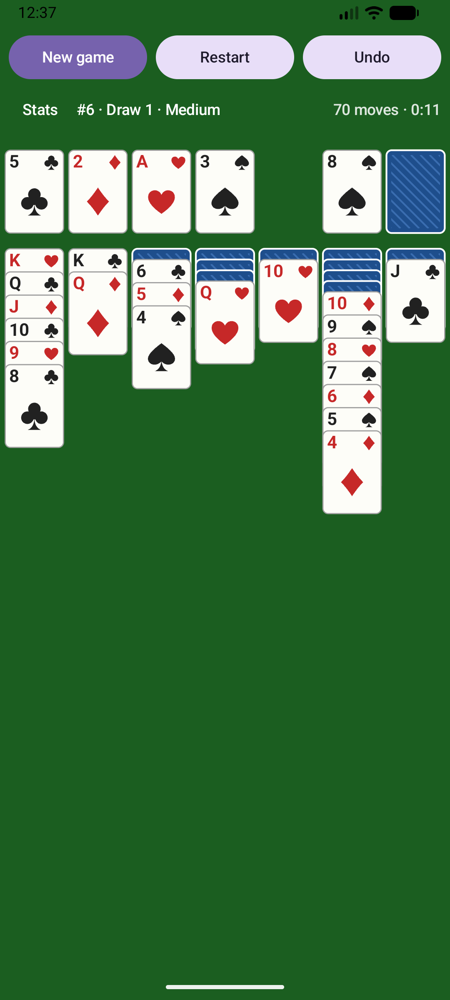
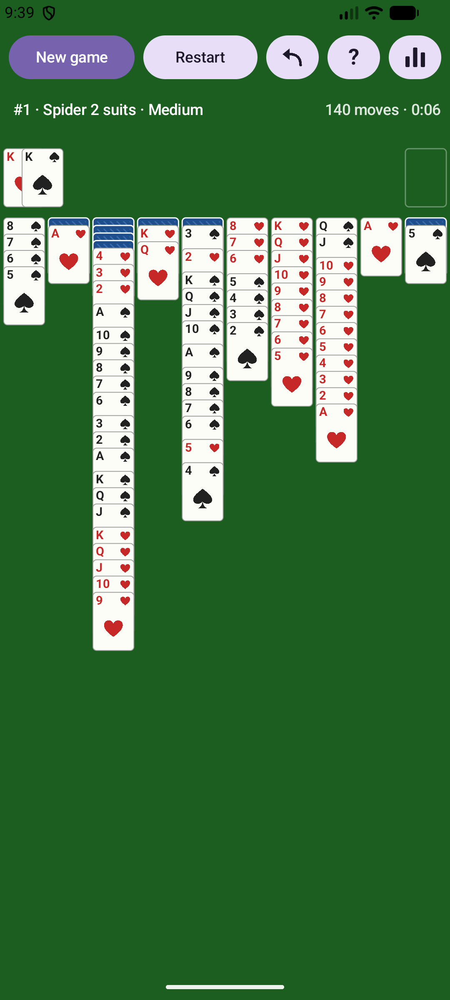
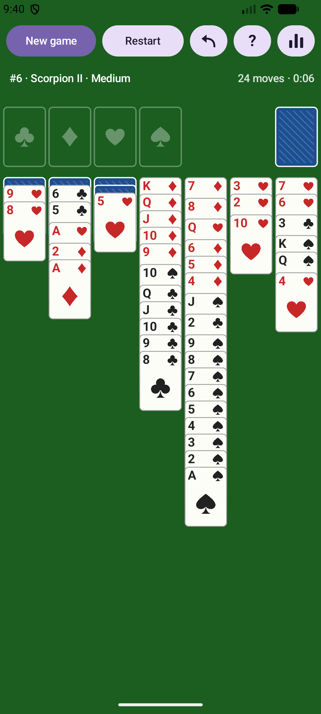
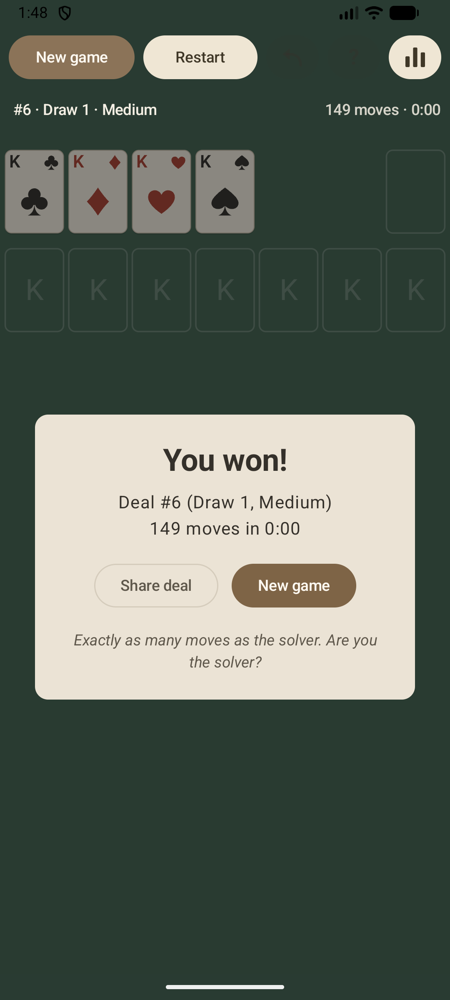
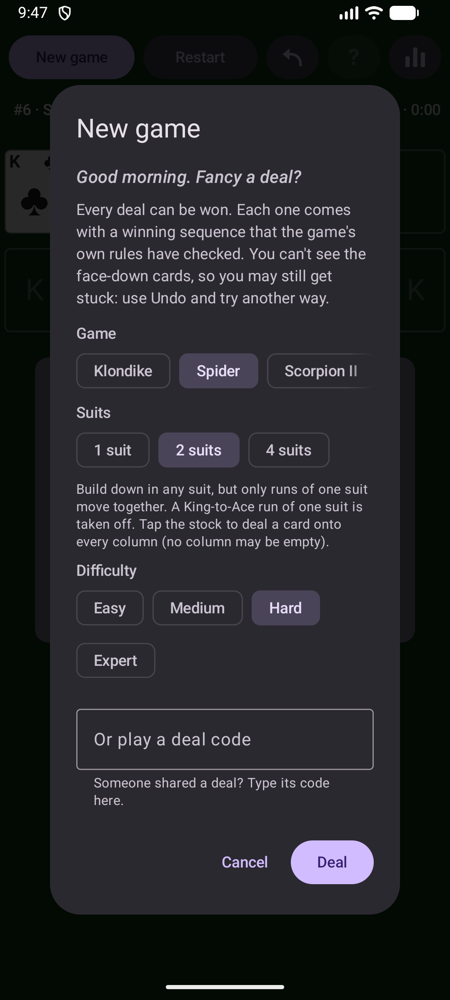
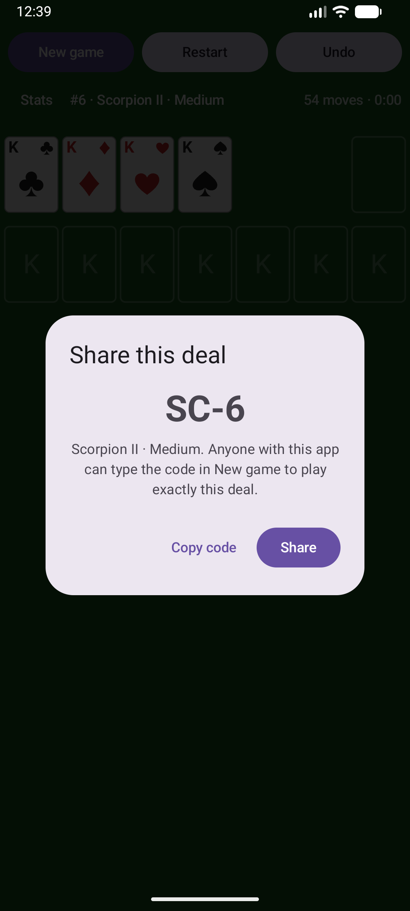
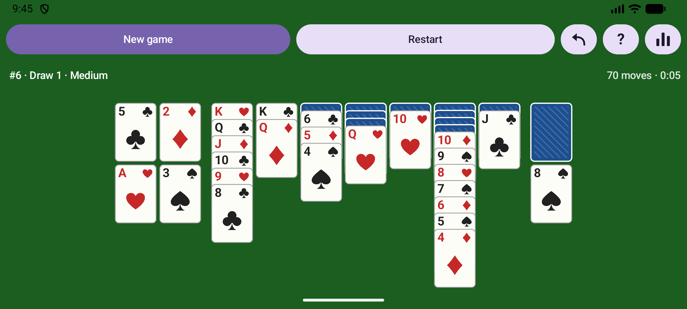

# Solitaire

> [!WARNING]
> **Disclaimer: this app is FULLY vibe coded, for personal use only.** All of the code was written by an AI
> coding agent (Claude Code), directed by the owner but not written or reviewed line by line by a person.
> It comes with no warranty and no support, and it is not intended for distribution or production use.
> Use it at your own risk.

An open-source patience (solitaire) game for Android, with Klondike, Spider, Scorpion II, Yukon, Russian
Solitaire and FreeCell, where
**every deal is proven winnable**.
Deals can be very hard, but each one comes with a stored winning sequence that has been replayed through
the game's own rules engine before it is dealt to you.

No ads, no analytics, no accounts, and no network access (the app has no `INTERNET` permission).

## Download

Get the signed APK from the [latest release](https://github.com/ThomasVanRiel/solitaire/releases/latest)
and open it on your phone (Android 8.0 or newer; allow installing apps from your browser or file manager
when asked). The app is not on any app store. To update, install the newer APK over the old one; your saved
game and statistics are kept.

## Screenshots

| Klondike | Spider (2 suits) | Scorpion II |
|:---:|:---:|:---:|
|  |  |  |

| Won | New game (dark mode) | Share a deal |
|:---:|:---:|:---:|
|  |  |  |



## Features

**Games**
- **Klondike** with draw 1 or draw 3, unlimited passes through the stock. When every card is face up, the
  game finishes itself.
- **Spider** with 1, 2 or 4 suits (two decks, ten columns). Only runs of one suit move together; a
  complete King-to-Ace run of one suit is taken off automatically. A deal needs every column filled.
- **Scorpion II**: one deck, seven columns, build down in suit. Any face-up card moves together with
  everything on top of it, only Kings fill empty columns, and the three reserve cards are dealt once.
  Complete runs are taken off automatically.
- **Yukon**: one deck, seven columns, no stock. Build down in alternating colours; any face-up card moves
  together with everything on top of it, in order or not. Only Kings fill empty columns.
- **Russian Solitaire**: Yukon, but build down in suit. Much harder: only about 1 deal in 15 can be won,
  and the app only deals those.
- **FreeCell**: every card face up in eight columns, four free cells that hold one card each, any card into
  an empty column. A run moves in one go when there is room to move it card by card.
- In every game, a card that reaches a foundation stays there: it is out of play.
- Four difficulty levels per game: Easy, Medium, Hard and Expert.

**Playing**
- Tap a card to send it to the best place, or drag it; legal targets light up while you drag. Cards glide
  unhurriedly to their new place.
- A calm, soft look: muted sage felt, warm linen cards and gentle fades instead of sudden pop-ups.
- Unlimited undo, and a Restart button to replay the same deal from the start.
- Failed moves are counted: tapping a card that has nowhere to go, dropping a card where it can't go, or
  dealing in Spider with an empty column. The count shows next to the moves once there is one, and on the
  win screen.
- When the rest of the game is a formality (nothing face down, every column in order), it finishes itself.
- The top row holds New game and Restart, then three icon buttons: Undo (a curved arrow), Hint (?) and
  Statistics (a bar chart). The icons are drawn in code.
- **Hint** outlines a move that helps (turns a card over, plays a card from the stock, or leads to one).
  It is just a possible move, not the best one, so it never solves the deal for you.
- When no move that helps is left anywhere, a message says the position can't be won any more and offers
  Undo.
- In Spider and Scorpion II there is a little extra space wherever a same-suit sequence breaks, so valid
  sequences sit together.
- The stock sits on the right, under your thumb; the foundations are on the left. In landscape they move
  beside the columns: foundations down the left edge, the stock down the right.
- Your game is saved after every move, and survives the app being closed or killed.

**Sharing and statistics**
- **Deal codes**: tap the deal info at the top (or *Share deal* on the win screen) to see a short code such
  as `S2-17`, and copy it or send it with the share sheet. Type a code in *New game* to play that exact
  deal. Codes are a two-letter variant (`K1`, `K3`, `S1`, `S2`, `S4`, `SC`, `YU`, `RU`, `FC`) and the deal number; only deals
  in the app's packs can be played. Sharing uses Android's share sheet, so the app still needs no network
  access.
- Statistics per game variant and difficulty: games played and won, win rate, streaks, fastest win, fewest
  moves, average time, moves, failed moves and undos per win, time played, wins without undo or hints,
  hints, undos, restarts and times stuck, and days played with the run of days in a row, plus an *All
  games* view with the totals. The app never sends them anywhere; Android's own backup and phone-to-phone
  transfer may include them, together with the saved game. The bottom of the screen shows the app version
  and a link to the source on GitHub, where new versions are published.

**A bit of silliness**
- A fortune-cookie line on the win screen (well over a hundred of them): random (picked from the deal
  number, so a shared deal gets the same one), or about the game you just played, a record, a streak, the
  time of day or a holiday (New Year, Valentine's, Pi day, May the 4th, midsummer, Talk Like a Pirate Day,
  Halloween, the winter solstice, Christmas, leap day and Friday the 13th among them).
- A greeting in *New game* that depends on the time, the day of the week, the date and how long you've
  been away.
- Sarcastic, slightly dark quips when you're stuck, when you leave a game unwon, and when you restart.
- 55 achievements, from *Beginner's Luck* to *Statistically Suspicious*. A small banner pops up when you
  earn one (it lets taps through and goes away by itself); *Statistics* lists them all.
- Very rarely, after a fast or tidy win, a few cards hold up judges' scores.

Cards are drawn in code: no image assets.

## How the guarantee works

1. **One rules engine.** The game and the solver share exactly one implementation of the rules
   (`engine/.../rules/Rules.kt`), so "legal for the solver" and "legal in the game" can't differ.
2. **A solver finds a win.** A depth-first solver that can see every card searches for a winning move
   sequence for each candidate deal. Deals it can't solve within its budget are skipped.
3. **Every win is replayed.** `ProofVerifier` deals the cards again from the seed, checks every stored
   move with the rules engine, plays it, and requires a won game at the end. This happens when the deal
   packs are made, again in the test suite for every shipped deal, and once more in the app right before a
   deal is served. A deal whose proof doesn't replay is never shown.
4. **Undo keeps it winnable.** With unlimited undo you can always get back to a position that can be won.

"Winnable" means winnable with perfect play and knowledge of the face-down cards. You can't see those, so
you can still get stuck and need to undo. That's how every "winnable deals" mode works.

**Difficulty** is measured for a player who *can't* see the hidden cards: a simple computer player that
only looks at face-up cards plays each deal 30 times, and the share of games it wins sets the tier. In
Klondike, Scorpion II, Yukon and Russian, Expert deals were never won by it, yet the solver proved them
winnable. In Spider that simple player hardly ever wins, so a lost game also scores partial credit for how
far it got (cards turned over, runs completed), and the tiers are set on that score. FreeCell works the
same way, with credit for the cards it got onto the foundations.

Deals are numbered by seed (shown as `#1234`). The shuffle algorithm is versioned and pinned by tests, so a
deal number always gives the same deal.

## Project layout

| Module | What it is |
|---|---|
| `engine/` | Pure Kotlin/JVM: cards, rules for every game, shuffle, solvers, proof verifier, difficulty rater, deal pack format. No Android dependencies. |
| `dealgen/` | Command-line tool that generates the verified deal packs. |
| `extras/` | Pure Kotlin: win fortunes, greetings, stuck and loss quips, achievements. |
| `tools/` | `screenshot.sh`: plays a deal code to a given move on a device and saves a screenshot. |
| `app/` | The Android app (Jetpack Compose). |

## Building

Requirements: JDK 17 or newer, and the Android SDK (only for the app module). **New machine?** Follow
[`docs/SETUP.md`](docs/SETUP.md): installing the tools, building, the emulator and generating packs, step by
step for Linux and Windows.

```sh
./gradlew :engine:test          # engine tests, no device needed
./gradlew :extras:test          # fortunes, quips and achievements
./gradlew :app:assembleDebug    # build the debug APK
./gradlew :app:installDebug     # install on a connected device or emulator
./gradlew :app:lint             # Android lint

# Generate the deal packs the app ships (solve, verify and rate deals):
./gradlew :dealgen:run --args="--per-tier 2500"
```

The packs currently shipped hold 2500 deals per difficulty per game variant (`--per-tier 2500`), about
7.9 MB in total. All options are listed under [Deal packs](#deal-packs).

If no Android SDK is found (`ANDROID_HOME`, or `sdk.dir` in `local.properties`), the `:app` module is
skipped so that the engine and deal generator can still be built and tested.

Release builds (`./gradlew :app:assembleRelease`) are minified with R8; `tools/build-release.sh` builds one and copies it to the project root. See `RELEASING.md` for signing.

### Benchmark

```sh
./gradlew :engine:test -Pbench --tests '*SolverBenchmark' -PbenchSeeds=1000 -PbenchNodes=1000000
# Other rule sets (names as in RuleSet.kt):
./gradlew :engine:test -Pbench --tests '*SolverBenchmark' -PbenchRules=SPIDER_2_SUITS,SCORPION_II
```

On a desktop JVM, about 84% of draw-1 deals and 77% of draw-3 deals are solved, with a median of a few
milliseconds. Spider 1 and 2 suits and FreeCell solve almost always, Yukon 87%; 4-suit Spider and
Scorpion II much less often, and most Russian deals are proved unwinnable (only solved deals are shipped). The full numbers are in [`docs/DESIGN.md`](docs/DESIGN.md#benchmark).

## Deal packs

The app ships verified deals in `app/src/main/assets/deals/`, one gzipped file per rule set and difficulty
(`draw_1_unlimited_easy.wpak`, `spider_2_suits_hard.wpak`, `scorpion_ii_expert.wpak`, ...). The `dealgen`
tool makes them:
- it solves each seed and replays the solution through the rules engine (`ProofVerifier`);
- it rates the difficulty and writes the packs;
- it reads every pack back and checks every proof again.

`./gradlew :engine:test` also replays every shipped proof, so a bad pack fails the build.

```sh
./gradlew :dealgen:run --args="--per-tier 2500"
```

| Option | Default | Meaning |
|---|---|---|
| `--rules draw1,draw3,...` | all | Rule sets to generate: `draw1`, `draw3`, `spider1`, `spider2`, `spider4`, `scorpion2`, `yukon`, `russian`, `freecell` |
| `--per-tier N` | 2500 | Deals per difficulty tier per rule set |
| `--start-seed S` | 1 | First seed to try |
| `--threads T` | CPU count − 1 | Worker threads |
| `--playouts P` | 30 | Heuristic-player games per deal, for the difficulty rating |
| `--nodes N` | 300000 | Solver node budget per deal (deals that run out are skipped) |
| `--out DIR` | `app/src/main/assets/deals` | Output folder |
| `--calibrate N` | off | Only rate the first N winnable deals and print the rating histogram |

The generator runs with a 2 GB heap; with many threads give it more with `-PdealgenHeap=8g` (a Gradle
property, so it goes before `--args`).

The output is deterministic for the same options. Each solution is stored as one byte per move: the move's
index in the rules engine's legal-move list (an index of 255 or more, which only Spider can reach, takes
three bytes). After gzip that comes to about 85 bytes per Klondike deal, 20 for Scorpion II, 20–40 for
Yukon and Russian, 70 for FreeCell, and 90–250 for Spider (longer solutions).

### Cost of generating the packs

The shipped packs (`--per-tier 2500`, 90,000 deals) took 50 minutes on an i7-14700K (28 threads, 27
workers). The CPU ran at its 253 W power limit the whole time, so generation used about **0.21 kWh**
(CPU package only, measured with btop), which is about 2.4 mWh (8.5 J) per deal, or roughly 6 cents of
electricity. 4-suit Spider and Scorpion II used 82% of it, because few of their deals are solved.

| Game | Seeds tried | Time | CPU energy |
|---|---:|---:|---:|
| Scorpion II | 138,294 | 1,517.5 s | 107 Wh |
| Spider, 4 suits | 69,946 | 974.9 s | 69 Wh |
| Klondike, draw 1 | 21,281 | 183.0 s | 13 Wh |
| Klondike, draw 3 | 24,679 | 170.5 s | 12 Wh |
| Yukon | 19,700 | 103.8 s | 7.3 Wh |
| Spider, 2 suits | 11,322 | 27.5 s | 1.9 Wh |
| Russian | 327,925 | 20.0 s | 1.4 Wh |
| FreeCell | 12,007 | 11.4 s | 0.8 Wh |
| Spider, 1 suit | 11,379 | 7.7 s | 0.5 Wh |
| **Total** | **636,533** | **3,016 s** | **212 Wh** |

## Debug tools

Debug builds have an **Auto** button that restarts the deal and plays its stored winning sequence in the
real UI. It can also be started from adb:

```sh
adb shell am start -S -n io.github.thomasvanriel.solitaire/.MainActivity --ez autoplay true
```

For screenshots, `--ez hideDebugUi true` hides the Auto button and `--ei stopAt N` stops the replay after
N moves, so a mid-game position can be captured. `--ez scorecards true` always shows the rare scorecards
on the win screen, and `--es achievement night_owl` pops up that achievement (without unlocking it):

```sh
adb shell am start -S -n io.github.thomasvanriel.solitaire/.MainActivity \
    --ez autoplay true --ei stopAt 60 --ez hideDebugUi true
```

These tools live in the `debug` source set and are not in release builds.

`tools/screenshot.sh CODE MOVES OUT.png` uses them to retake the README screenshots (for example
`tools/screenshot.sh K1-6 70 screenshots/klondike.png`; `-1` plays to the win). `CLAUDE.md` lists the deal
and move for each one.

## Contributing

See `CONTRIBUTING.md`, and [`docs/DESIGN.md`](docs/DESIGN.md) for how the engine, solvers and app work.

## License

GPL-3.0-or-later. See `LICENSE`.
