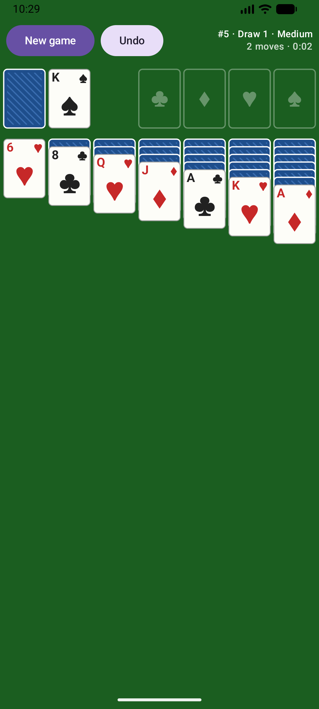
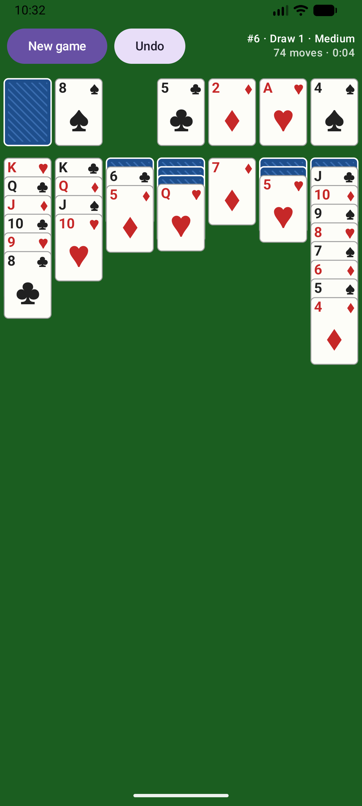

# Solitaire

An open-source Klondike patience (solitaire) game for Android where **every deal is proven winnable**.
Deals can be very hard, but each one comes with a stored winning sequence that has been replayed through
the game's own rules engine before it is dealt to you.

No ads, no analytics, no accounts, and no network access (the app has no `INTERNET` permission).

## Screenshots

| Start | Mid-game | Won | New game (dark mode) |
|:---:|:---:|:---:|:---:|
|  |  |  |  |


## Features

- Klondike with draw 1 or draw 3, unlimited passes through the stock.
- Four difficulty levels: Easy, Medium, Hard and Expert.
- Unlimited undo, and a Restart button to replay the same deal from the start.
- Statistics per draw mode and difficulty: games played and won, win rate, streaks, fastest win, fewest
  moves, and wins without undo. They stay on your phone.
- The stock sits on the right, under your thumb; the foundations are on the left.
- Tap a card to send it to the best place, or drag it; legal targets light up while you drag.
- When every card is face up, the game finishes itself.
- Your game is saved after every move, and survives the app being closed or killed.
- Cards are drawn in code: no image assets.

## How the guarantee works

1. **One rules engine.** The game and the solver share exactly one implementation of the rules
   (`engine/.../rules/Rules.kt`), so "legal for the solver" and "legal in the game" can't differ.
2. **A solver finds a win.** A depth-first solver that can see every card searches for a winning move
   sequence for each candidate deal. Deals it can't solve within its budget are skipped.
3. **Every win is replayed.** `ProofVerifier` deals the cards again from the seed, checks every stored
   move with the rules engine, plays it, and requires a won game at the end. This happens when the deal
   packs are made, again in the test suite for every shipped deal, and once more in the app right before a
   deal is served. A deal whose proof doesn't replay is never shown.
4. **Undo keeps it winnable.** With unlimited undo you can always get back to a position that can be won.

"Winnable" means winnable with perfect play and knowledge of the face-down cards. You can't see those, so
you can still get stuck and need to undo. That's how every "winnable deals" mode works.

**Difficulty** is measured for a player who *can't* see the hidden cards: a simple computer player that
only looks at face-up cards plays each deal 30 times, and the share of games it wins sets the tier. Expert
deals were never won by it, yet the solver proved them winnable.

Deals are numbered by seed (shown as `#1234`). The shuffle algorithm is versioned and pinned by tests, so a
deal number always gives the same deal.

## Project layout

| Module | What it is |
|---|---|
| `engine/` | Pure Kotlin/JVM: cards, rules, shuffle, solver, proof verifier, difficulty rater, deal pack format. No Android dependencies. |
| `dealgen/` | Command-line tool that generates the verified deal packs. |
| `app/` | The Android app (Jetpack Compose). |

## Building

Requirements: JDK 17 or newer, and the Android SDK (only for the app module).

```sh
./gradlew :engine:test          # engine tests, no device needed
./gradlew :app:assembleDebug    # build the debug APK
./gradlew :app:installDebug     # install on a connected device or emulator
./gradlew :app:lint             # Android lint

# Generate the deal packs the app ships (solve, verify and rate deals):
./gradlew :dealgen:run --args="--per-tier 2500"
```

The packs currently shipped hold 100 deals per difficulty per draw mode (`--per-tier 100`).
`--per-tier 2500` takes about an hour on 7 threads and adds about 1.7 MB to the app. All options are
listed under [Deal packs](#deal-packs).

If no Android SDK is found (`ANDROID_HOME`, or `sdk.dir` in `local.properties`), the `:app` module is
skipped so that the engine and deal generator can still be built and tested.

Release builds (`./gradlew :app:assembleRelease`) are minified with R8. See `RELEASING.md` for signing.

### Benchmark

```sh
./gradlew :engine:test -Pbench --tests '*SolverBenchmark' -PbenchSeeds=1000 -PbenchNodes=1000000
```

On a desktop JVM, about 84% of draw-1 deals and 77% of draw-3 deals are solved, with a median of a few
milliseconds. The full numbers are in `PROGRESS.md`.

## Deal packs

The app ships verified deals in `app/src/main/assets/deals/`, one gzipped file per rule set and difficulty
(`draw_1_unlimited_easy.wpak`, ...). The `dealgen` tool makes them:
- it solves each seed and replays the solution through the rules engine (`ProofVerifier`);
- it rates the difficulty and writes the packs;
- it reads every pack back and checks every proof again.

`./gradlew :engine:test` also replays every shipped proof, so a bad pack fails the build.

```sh
./gradlew :dealgen:run --args="--per-tier 2500"
```

| Option | Default | Meaning |
|---|---|---|
| `--rules draw1,draw3` | both | Rule sets to generate |
| `--per-tier N` | 2500 | Deals per difficulty tier per rule set |
| `--start-seed S` | 1 | First seed to try |
| `--threads T` | CPU count − 1 | Worker threads |
| `--playouts P` | 30 | Heuristic-player games per deal, for the difficulty rating |
| `--nodes N` | 300000 | Solver node budget per deal (deals that run out are skipped) |
| `--out DIR` | `app/src/main/assets/deals` | Output folder |
| `--calibrate N` | off | Only rate the first N winnable deals and print the win-rate histogram |

The output is deterministic for the same options. Each solution is stored as one byte per move: the move's
index in the rules engine's legal-move list. That comes to about 85 bytes per deal after gzip.

## Debug tools

Debug builds have an **Auto** button that restarts the deal and plays its stored winning sequence in the
real UI. It can also be started from adb:

```sh
adb shell am start -S -n io.github.thomasvanriel.solitaire/.MainActivity --ez autoplay true
```

These tools live in the `debug` source set and are not in release builds.

## Contributing

See `CONTRIBUTING.md`.

## License

GPL-3.0-or-later. See `LICENSE`.
